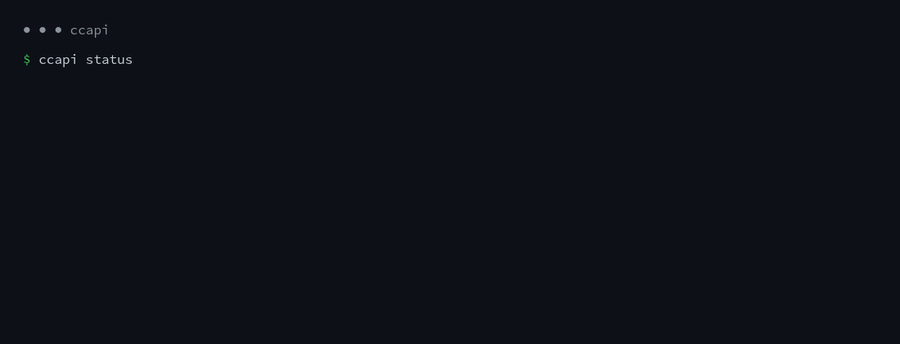

<p align="center">
  
</p>

<p align="center">
  <b>Your Claude Code subscription, as an Anthropic-compatible API.</b><br>
  Point any Anthropic SDK, LiteLLM or agent framework at localhost. Tools, streaming and images included.
</p>

<p align="center">
  <a href="https://github.com/S-kkipie/ccapi/actions/workflows/test.yml"></a>
  
  
  
</p>

<p align="center">
  
</p>

<p align="center">English · <a href="README.es.md">Español</a></p>

---

You already pay for Claude Code. ccapi lets the rest of your tools use it too: scripts, LiteLLM, agent frameworks, anything that speaks the Anthropic Messages API. It runs a Claude Code session with two small mods and serves `/v1/messages` on `127.0.0.1`. Change the base URL and keep your code.

## Highlights

- **Drop-in.** Same endpoint, same SSE events, same error shapes as the Anthropic API.
- **Native tools.** Your tools become real Claude Code tools, parallel calls included. Your `tool_result` resumes the very same subagent: no prompt tricks, no re-sent history.
- **Images and PDFs**, in messages and inside tool results.
- **Real streaming**, token by token, straight from Claude Code's own turn.
- **Thinking and effort**, `stop_sequences`, `/v1/models`, `count_tokens`.
- **Hands off your credentials.** ccapi never reads your OAuth token and never calls Anthropic's API itself. Everything goes through Claude Code.

## Quick start

You need [Claude Code](https://docs.claude.com/en/docs/claude-code) 2.1.291 or newer (it brings mods), [Bun](https://bun.sh) and tmux, on Linux, macOS or WSL.

```bash
git clone https://github.com/S-kkipie/ccapi && cd ccapi
ln -s "$PWD/bin/ccapi" ~/.local/bin/ccapi

ccapi start     # Claude Code + both mods, in a tmux session named "ccapi"
ccapi attach    # first run only: trust the folder, then detach with Ctrl-b d
ccapi status    # {"ok":true,...}
ccapi token     # your local API key
```

Say hi:

```bash
curl http://127.0.0.1:18787/v1/messages \
  -H "x-api-key: $(ccapi token)" \
  -H "anthropic-version: 2023-06-01" \
  -H "content-type: application/json" \
  -d '{"model":"claude-sonnet-5-5","max_tokens":512,"messages":[{"role":"user","content":"Hello!"}]}'
```

## Use it from

**Anthropic SDK (TypeScript)**

```ts
import Anthropic from '@anthropic-ai/sdk'

const client = new Anthropic({ apiKey: process.env.CCAPI_TOKEN, baseURL: 'http://127.0.0.1:18787' })
```

**Anthropic SDK (Python)**

```python
import os
import anthropic

client = anthropic.Anthropic(api_key=os.environ["CCAPI_TOKEN"], base_url="http://127.0.0.1:18787")
```

**LiteLLM**, for OpenAI-compatible clients (a full config lives in [`e2e/litellm.yaml`](e2e/litellm.yaml)):

```yaml
model_list:
  - model_name: claude-sonnet
    litellm_params:
      model: anthropic/claude-sonnet-5-5
      api_base: http://127.0.0.1:18787
      api_key: os.environ/CCAPI_TOKEN
```

```bash
LITELLM_MASTER_KEY=sk-... CCAPI_TOKEN=$(ccapi token) uvx --from 'litellm[proxy]' litellm --config e2e/litellm.yaml
```

**Hermes Agent**, and other clients that only take a custom Anthropic URL when it ends in `/anthropic`. ccapi accepts that prefix:

```yaml
# ~/.hermes/config.yaml
model:
  default: claude-sonnet-5-5
  provider: anthropic
  base_url: http://127.0.0.1:18787/anthropic
  api_mode: anthropic_messages
```

```bash
# ~/.hermes/.env (ANTHROPIC_TOKEN wins over CLAUDE_CODE_OAUTH_TOKEN and ANTHROPIC_API_KEY)
ANTHROPIC_TOKEN=<ccapi token>
```

Models: `claude-opus-5-5`, `claude-sonnet-5-5`, `claude-haiku-4-5-20251001`, the aliases `opus`, `sonnet`, `haiku`, and any other `claude-*` id your Claude Code accepts.

## Run it 24/7

On a server, keep it up with a systemd user unit that restarts Claude Code if it ever exits (after the first `ccapi attach`, so the folder is trusted):

```bash
ccapi install-service
loginctl enable-linger "$USER"   # start at boot, without a login session
systemctl --user start ccapi
```

If your client runs on another machine, an SSH reverse tunnel puts the port on that machine's localhost without exposing anything:

```bash
ssh -N -o ServerAliveInterval=30 -o ExitOnForwardFailure=yes -R 127.0.0.1:18787:127.0.0.1:18787 user@host
```

## What's supported

| Feature | Status |
| --- | --- |
| `POST /v1/messages`, JSON and SSE streaming | ✅ |
| Tools, parallel tool calls, `tool_choice` | ✅ `any` and `tool` are instructions, not hard constraints |
| Images and PDFs, in messages and in `tool_result` | ✅ |
| Extended thinking, effort | ✅ |
| `stop_sequences`, `max_tokens` | ✅ `max_tokens` is approximate |
| `GET /v1/models`, `POST /v1/messages/count_tokens` | ✅ token counts are estimates |
| Multi-turn conversations | ✅ native continuation; an edited history is replayed as text |
| `temperature`, `top_p`, `top_k`, `cache_control` | ignored (Claude Code caches on its own) |
| Message Batches, Files API | ❌ |

## How it works

`ccapi start` opens a Claude Code session in tmux with two mods. The core mod starts a small Bun server on `127.0.0.1` and registers your client's tools as real Claude Code tools. Every API request becomes a Claude Code subagent whose system prompt is your `system`.

When the model calls one of your tools, ccapi answers your request with `stop_reason: "tool_use"` and parks the subagent. Your next request carries the `tool_result`, which resumes that same subagent instead of starting over. Streaming events come straight from the engine's turn, and images reach the model as native tool-result images.

The spawner is a separate mod because a mod can't observe the subagents it spawns itself.

## Configuration

| Option | Default | What it does |
| --- | --- | --- |
| `max_concurrent` | 4 | Subagents running at once; extra requests wait in a queue |
| `queue_size` | 16 | Requests that may wait before ccapi answers 429 |
| `tool_wait_minutes` | 10 | How long a parked tool call waits for your `tool_result` |
| `expose_thinking` | `requested` | When thinking blocks reach you: `requested`, `always`, `never` |
| `debug_bodies` | false | Write request bodies to the request log |

Each option is a row in `/config` inside the ccapi session (`ccapi attach`). `CCAPI_PORT` changes the port (default `18787`) and `CCAPI_SERVER_DIR` the session's folder (default `~/.ccapi/server`). Requests are logged to `~/.local/state/ccapi/requests.jsonl`.

| Command | |
| --- | --- |
| `ccapi start` / `stop` | Start or stop the tmux session |
| `ccapi status` | Health of the API |
| `ccapi token` | Print the local API key (stored in `~/.config/ccapi/token`, mode 0600) |
| `ccapi attach` | Open the session (detach with Ctrl-b d) |
| `ccapi install-service` | Install the systemd user unit |

## Good to know

- The system prompt always starts with "You are a Claude agent, built on Anthropic's Claude Agent SDK." Claude Code adds it to every subagent and it can't be removed.
- Every request spends your plan's usage, like any Claude Code session.
- If the session closes, the API goes down with it. `ccapi install-service` brings it back on its own.
- Mods you installed with `/plugin install` also load in the ccapi session and can see its subagents. Mods loaded through `CLAUDE_CODE_PLUGIN_DIRS` don't.
- Claude Code's mods API is in early access and may change.

## Use it responsibly

ccapi is for personal use on your own machine. It spends your own plan through Claude Code itself. Keep it on localhost, keep your token private, and don't serve other people from your subscription: Anthropic's [Consumer Terms](https://www.anthropic.com/legal/consumer-terms) don't allow routing third-party traffic through Free, Pro or Max plans. For products and teams, use an [Anthropic API key](https://console.anthropic.com).

## Development

```bash
bun install
bun run test          # unit tests (pure core + bridge)
bun run typecheck
bun run test:plugin   # claude plugin test
bun run validate      # claude plugin validate
bun run e2e           # against a running server (ccapi start)
```

Issues and pull requests are welcome. Please keep the core in `plugins/ccapi/src` free of Node and DOM APIs (mods run without them), and put tests next to the code in `__tests__/`.

## License

[MIT](LICENSE). ccapi is an independent project, not affiliated with or endorsed by Anthropic. Claude and Claude Code are trademarks of Anthropic, PBC.
